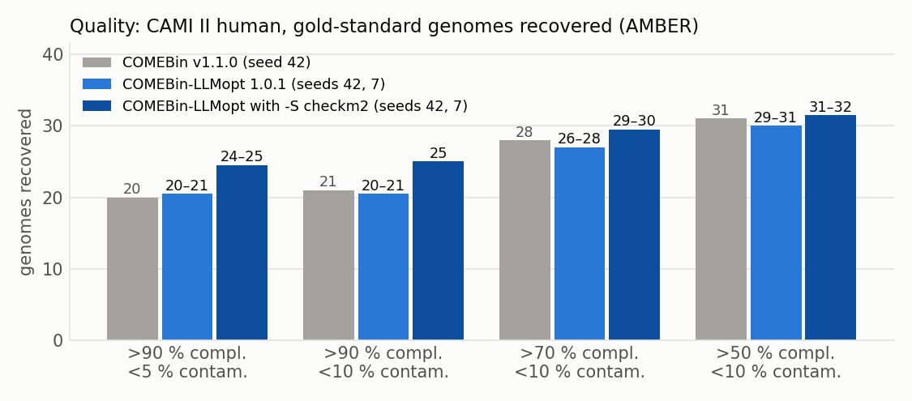

# COMEBin-LLMopt

**COMEBin-LLMopt** bins metagenomic contigs with contrastive multi-view representation
learning. It is a faster, more robust version of
[COMEBin](https://github.com/ziyewang/COMEBin) v1.1.0 by Ziye Wang et al., improved with
the help of an LLM coding agent and benchmarked against the original on fixed datasets.

COMEBin-LLMopt is not an official COMEBin release, and the COMEBin authors have not
reviewed it. It is distributed under GPL-3.0 like COMEBin. See [NOTICE.md](NOTICE.md)
for the modification notice and [CHANGELOG.md](CHANGELOG.md) for every change.

## Citation

If you use COMEBin-LLMopt, please credit **both** the COMEBin method and this version:

1. **COMEBin:** Wang, Z., You, R., Han, H. et al. Effective binning of metagenomic contigs
   using contrastive multi-view representation learning. *Nat Commun* 15, 585 (2024).
   <https://doi.org/10.1038/s41467-023-44290-z>
2. **COMEBin-LLMopt:** Zierep, P. COMEBin-LLMopt: an LLM-optimized, faster COMEBin (version 1.0.2).
   <https://github.com/paulzierep/COMEBin-LLMopt>

Please also give the version you used (`comebin-llmopt -V`).

## How COMEBin-LLMopt was made

COMEBin-LLMopt is an experiment in how well an AI coding agent can improve an established,
high-quality scientific tool. We chose COMEBin because it is one of the best metagenomic
binners available.

- **Agent:** an autonomous AI coding agent (Claude Code) runs on a de.NBI Cloud VM
  (32 AMD EPYC cores, CPU only). Paul Zierep sets the goals and steers it through GitHub issues.
- **Loop:** the agent works in a fixed loop:
  1. Profile the slowest stage.
  2. Change it on the `dev` branch and add tests (`tests/`).
  3. Run the whole pipeline against COMEBin v1.1.0 on fixed benchmark datasets (for example
     BATS medium and CAMI II human), scored with CheckM2 and, against gold standards, with AMBER.
  4. Use at least two seeds, because seed noise is about 1–2 genomes.
- **Rule:** a change is merged into `master` only if the benchmark shows it is as good or
  better. Changes that did not help, such as a lower loss temperature, were rejected, and
  that is recorded too.
- **One job at a time:** runs never overlap, so wall times are comparable.
- **Record:** every change, with its measured effect, is listed in [CHANGELOG.md](CHANGELOG.md).

## What is different from COMEBin v1.1.0

The method and default parameters are the same. Bins are the same within seed noise,
and a run takes 2.6–2.8× less time on CPUs (CAMI II human: 33 instead of 85 min;
BATS medium: 14 instead of 39 min; 32 threads).


**Speed and memory**
- **InfoNCE loss:** the log-sum-exp over negatives is taken once per anchor instead of building a 30,720 × 6,139 logits matrix. The loss step is 4.5× faster and peaks 1.8 GB lower; loss, gradients and accuracy are unchanged.
- **Training batches:** the training views are already in memory, so batches are gathered directly and no DataLoader workers are forked each epoch.
- **Dropout:** CPU dropout masks come from random bytes, 4.5× faster than `bernoulli_` (17 % faster training step).
- **Coverage features:** bedGraph statistics are vectorised with NumPy, 1.7× faster.
- **CheckM gene calls:** the archaeal CheckM pass reuses the bacterial pass's Prodigal gene calls.

**New options**
- `-L INT`: bin only contigs of at least INT bp (default 1001). For large assemblies, `-L 2500` cuts run time several-fold.
- `-s INT`: random seed for reproducible runs.
- `-V`: print the version.
- `-S checkm2` and `-D PATH`: choose the final bins across all Leiden partitions with CheckM2 (see below).
- `-X`: split final bins whose marker genes show contamination (on `dev`/`master`, not yet released; see CHANGELOG).
- If `-l` (temperature) is not given, it is chosen from the N50: 0.07 above 10 kb, otherwise 0.15.

**Robustness**
- Small assemblies (≤ `-m` contigs) no longer crash. The HNSW neighbour count is capped at n − 1.
- No usable marker seeds now gives empty outputs plus `NO_BINS.txt`, and the run exits 0.
- CheckM failures now stop the run. Previously their exit codes were ignored.
- An interrupted run no longer reuses incomplete intermediate files.
- The log shows the wall time of every stage.

## Better bins: `-S checkm2` (new, opt-in)

COMEBin clusters the contig embeddings with Leiden about 120 times (different resolutions and
bandwidths) and keeps the one partition with the best marker-gene score. Often a genome is binned
well in one partition and badly in the chosen one. With `-S checkm2`, COMEBin-LLMopt instead picks
the best bins from all partitions:

1. The assembly is annotated once (Prodigal in parallel, plus CheckM2's DIAMOND search).
2. Every distinct candidate bin gets CheckM2 completeness and contamination. CheckM2's own models
   run on per-bin sums of per-contig features, which matches `checkm2 predict` at r ≥ 0.995.
3. Bins are picked greedily by completeness − 4 × contamination; the contigs of a picked bin are
   removed from all other candidates, which are then rescored.
4. Leftover contigs keep their bins from the partition COMEBin chose, so viruses and plasmids that
   CheckM2 cannot score are not lost.

On CAMI II human this recovers 24–25 gold-standard genomes at > 90 % completeness and < 5 %
contamination instead of 20–21, for about 11 % more run time (36 instead of 32 min).



`-S checkm2` needs [CheckM2](https://github.com/chklovski/CheckM2) and its database (`-D`, or
`checkm2 database --download`). Without CheckM2 the run falls back to the default selection
and logs a warning.

## How COMEBin works

1. **Data augmentation:** five augmented copies of each contig are made from random subsequences, giving six views per contig.
2. **Features:** nucleotide frequency (k-mer) and coverage features for every view.
3. **Contrastive learning:** a coverage network and a combined network learn low-dimensional embeddings that put views of the same contig close together.
4. **Clustering:** Leiden community detection on the embeddings; the final bins are chosen with single-copy marker genes (CheckM).

<p align="center">

</p>

## Install

From Bioconda (the package `comebin-llmopt` is under review):

```sh
conda create -n comebin-llmopt comebin-llmopt --channel conda-forge --channel bioconda --strict-channel-priority
conda activate comebin-llmopt
```

From source:

```sh
git clone https://github.com/paulzierep/COMEBin-LLMopt.git
cd COMEBin-LLMopt
conda env create -f comebin_env.yaml        # all dependencies except PyTorch
conda activate COMEBin
python -m pip install torch==2.13.0 --index-url https://download.pytorch.org/whl/cpu   # or a CUDA build
```

Then run `COMEBin/comebin-llmopt` (or `bash COMEBin/run_comebin.sh`, which takes the same options).

For `-S checkm2`, also install CheckM2 (for example `conda create -n checkm2 -c conda-forge -c bioconda checkm2`)
and put its `bin/` on the `PATH`; COMEBin-LLMopt runs the selection with CheckM2's own Python.

A Galaxy tool is under review in [tools-iuc](https://github.com/galaxyproject/tools-iuc/pull/8903).

## Run

Inputs: an assembly (FASTA) and one sorted BAM file per sample with the reads mapped to it.

```sh
comebin-llmopt -a contigs.fasta -p bam_dir/ -o out/ -t 32 -d cpu -s 42
```

Add `-S checkm2 -D /path/to/uniref100.KO.1.dmnd` for the CheckM2 bin selection (see above).
Use `-d cuda` to train on a GPU. `comebin-llmopt -h` lists all options. Results:

- `out/comebin_res/comebin_res_bins/`: one FASTA file per bin. Bins under 200 kb are not reported.
- `out/comebin_res/comebin_res.tsv`: contig ID and bin.

### Making the BAM files

`COMEBin/scripts/gen_cov_file.sh` maps reads to the contigs (adapted from MetaWRAP's `binning.sh`).
Paired reads (`reads_1.fastq reads_2.fastq ...`) are the default:

```sh
bash COMEBin/scripts/gen_cov_file.sh -a contigs.fasta -o bam_dir path_to_reads/*fastq

  -a STR          metagenomic assembly file
  -o STR          output directory (to save the coverage files)
  -b STR          directory for the bam files (optional)
  -t INT          number of threads (default=1)
  -m INT          amount of RAM available (default=4)
  -l INT          minimum contig length to bin (default=1000bp)
  --single-end    non-paired reads mode (provide *.fastq files)
  --interleaved   input read files contain interleaved paired-end reads
  -f              forward read suffix for paired reads (default="_1.fastq")
  -r              reverse read suffix for paired reads (default="_2.fastq")
```

Any other mapper works as well, as long as there is one sorted BAM file per sample.

## Tests

```sh
python -m pytest tests
```

## Bug reports

Report COMEBin-LLMopt problems at <https://github.com/paulzierep/COMEBin-LLMopt/issues>.
Contact the COMEBin authors only about COMEBin itself.

## Acknowledgements

COMEBin was developed by Ziye Wang, Ronghui You, Haitao Han, Wei Liu, Fengzhu Sun and
Shanfeng Zhu (see [Citation](#citation)).

This work was supported by the de.NBI Cloud within the German Network for Bioinformatics Infrastructure (de.NBI) and ELIXIR-DE (Forschungszentrum Jülich and W-de.NBI-001, W-de.NBI-004, W-de.NBI-008, W-de.NBI-010, W-de.NBI-013, W-de.NBI-014, W-de.NBI-016, W-de.NBI-022).

## References

1. Meyer F, Fritz A, Deng Z L, et al. Critical assessment of metagenome interpretation: the second round of challenges. *Nature Methods* 19, 429–440 (2022).
2. Parks D H, Imelfort M, Skennerton C T, et al. CheckM: assessing the quality of microbial genomes recovered from isolates, single cells, and metagenomes. *Genome Research* 25, 1043–1055 (2015).
3. UniteM: <https://github.com/dparks1134/UniteM>.
4. Pan S, Zhu C, Zhao X M, et al. A deep siamese neural network improves metagenome-assembled genomes in microbiome datasets across different environments. *Nature Communications* 13, 2326 (2022).
