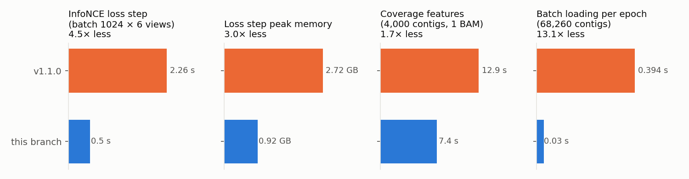

# COMEBin-LLMopt

**COMEBin-LLMopt** bins metagenomic contigs with contrastive multi-view representation
learning. It is a faster, more robust version of
[COMEBin](https://github.com/ziyewang/COMEBin) v1.1.0, improved with the help of
an LLM coding agent and benchmarked against the original on fixed datasets.

COMEBin-LLMopt is not an official COMEBin release, and the COMEBin authors have not
reviewed it. It is distributed under GPL-3.0 like COMEBin; see
[NOTICE.md](NOTICE.md) for the modification notice and
[CHANGELOG.md](CHANGELOG.md) for every change. If you use COMEBin-LLMopt, please cite
the COMEBin paper ([Citation](#Citation)).

```sh
comebin-llmopt -a contigs.fasta -p bam_dir/ -o out/ -t 32
```

`comebin-llmopt` takes the same options as COMEBin's `run_comebin.sh`, which still
works. Results are in `out/comebin_res/` as in COMEBin.

## What is different from COMEBin v1.1.0

Same method and default parameters; bins are identical up to floating-point
rounding. On BATS medium (3,000 contigs, 32 CPU threads) a run takes 19.5 min
instead of 38.5 min. Progress and open work are in [PROGRESS.md](PROGRESS.md).



**Speed and memory**
- **InfoNCE loss:** the log-sum-exp over negatives is taken once per anchor instead of building a 30,720 × 6,139 logits matrix. The loss step is 4.5× faster and peaks 1.8 GB lower; loss, gradients and accuracy are unchanged.
- **Coverage features:** bedGraph statistics are vectorised with NumPy, 1.7× faster, and `bedtools` is now the limiting step.
- **Training batches:** the training views are already in memory, so batches are gathered directly and no DataLoader workers are forked each epoch. Seeded batches are identical, and the `pymp-*` "Device or resource busy" errors on NFS temp dirs no longer occur.
- **CheckM gene calls:** the archaeal CheckM pass reuses the bacterial pass's Prodigal gene calls.

**Robustness**
- Small assemblies (≤ `-m` contigs, e.g. the tools-iuc test data with the default `-m 100`) no longer crash. The HNSW neighbour count is capped at n − 1.
- No usable marker seeds now gives an empty `comebin_res.tsv`, an empty `comebin_res_bins/` and `NO_BINS.txt`, and the run exits 0.
- CheckM failures now stop the run. Previously `os.system` ignored their exit codes and `sys.exit()` returned 0.
- An interrupted run no longer reuses incomplete CheckM profiles, truncated FragGeneScan proteins, or marker files older than the contig file.
- The log shows the wall time of every stage.

**Tests:** `python -m pytest tests`.

## Original COMEBin documentation

The sections below are from COMEBin v1.1.0. The installation steps install
COMEBin; for COMEBin-LLMopt, clone this repository instead and use `COMEBin/comebin-llmopt`.
Contact the COMEBin authors only about COMEBin itself; report COMEBin-LLMopt problems
at <https://github.com/paulzierep/COMEBin-LLMopt/issues>.

- [Overview](#overview)
- [System Requirements](#requirements)
- [Install COMEBin via bioconda](#install)
- [Install COMEBin via source code](#started)
- [A test dataset to demo COMEBin](#demo)
- [Preprocessing](#preprocessing)
- [How to run COMEBin](#runcomebin)
- [References](#References)
- [Contacts and bug reports](#contact)
  
## <a name="overview"></a>Overview
The framework of COMEBin is shown in the following figure, which is mainly divided into the following steps: 1) Data augmentation: construct five sets of augmented data by randomly extracting subsequences from the original contigs, resulting in six views for each original contig; 2) Construct feature vector: construct nucleotide frequency feature and coverage feature for each contig (including the original sequences and augmented sequences); 3) Contrastive learning: obtain low-dimensional embedding representations suitable for binning with heterogeneous information based on multi-view contrastive learning, and 4) Clustering: generate binning results based on community division algorithm Leiden.

Among them, the network structure used in contrastive learning includes two parts: 1) "Coverage network": process coverage features and 2) "Combine network": integrate the k-mer features and the "Coverage network" to obtain representations containing heterogeneous information.

<p align="center">

</p>

## <a name="requirements"></a>System Requirements
### Hardware requirements
COMEBin requires only a standard computer with enough RAM to support the in-memory operations.

### OS Requirements
COMEBin v1.1.0 is supported and tested in Linux systems.

## <a name="install"></a>Install COMEBin via bioconda
COMEBin can be installed from Bioconda with the GPU-enabled PyTorch build from conda-forge:
```sh
conda create -n comebin_env comebin pytorch-gpu cuda-version=13.0 \
  --channel conda-forge --channel bioconda --strict-channel-priority
conda activate comebin_env
```
For a CPU-only environment, use:

```sh
conda create -n comebin_env comebin pytorch-cpu \
  --channel conda-forge --channel bioconda --strict-channel-priority
conda activate comebin_env
```

The Bioconda package declares PyTorch as a runtime dependency. The `pytorch-gpu` and `pytorch-cpu` metapackages select the corresponding conda-forge build. The Bioconda installation uses the conda-forge PyTorch 2.13 build with CUDA 13.0 by default. To use CUDA 12.6 or another CUDA version not provided by conda-forge, please install COMEBin from source and then install the corresponding CUDA-enabled PyTorch build with pip.

## <a name="started"></a>Install COMEBin via source code
You can also install COMEBin from the source code. 
After installing Anaconda (or miniconda), first, obtain COMEBin:

```sh
git clone https://github.com/ziyewang/COMEBin.git
```
Then, create an environment to run COMEBin.

```sh
cd path_to_COMEBin
conda env create -f comebin_env.yaml
conda activate COMEBin
python -m pip install torch==2.13.0 --index-url https://download.pytorch.org/whl/cu126
```

`comebin_env.yaml` installs COMEBin's other dependencies but intentionally does not install PyTorch. The command above installs PyTorch 2.13.0 with CUDA 12.6 by default. For the CUDA 13.0 build or a CPU-only build, use the [official PyTorch installation selector](https://pytorch.org/get-started/locally/).

## <a name="demo"></a>A test dataset to demo COMEBin
We provide a small dataset to demo and test the software. Test data is available at https://drive.google.com/file/d/1xWpN2z8JTaAzWW4TcOl0Lr4Y_x--Fs5s/view?usp=sharing.
The inputs for COMEBin include contigs and BAM files (reads mapping to the contigs).
```sh
Contig file: comebin_test_data/BATS_SAMN07137077_METAG.scaffolds.min500.fasta.f1k.fasta
BAM files: comebin_test_data/bamfiles/SRR5720343.bam
```
Run COMEBin on the test dataset:
```sh
CUDA_VISIBLE_DEVICES=0 bash path_to_COMEBin/COMEBin/run_comebin.sh -a path_to_comebin_test_data/BATS_SAMN07137077_METAG.scaffolds.min500.fasta.f1k.fasta \
-p path_to_comebin_test_data/bamfiles \
-o path_to_comebin_test_data/run_comebin_test \
-n 6 \
-d cuda \
-t 40
```
Excepted output is given in path_to_comebin_test_data/run_comebin_test

```sh
Final result (bins): path_to_comebin_test_data/run_comebin_test/comebin_res/comebin_res_bins
Final result in tsv format: path_to_comebin_test_data/run_comebin_test/comebin_res/comebin_res.tsv
```


## <a name="preprocessing"></a>Preprocessing

The preprocessing steps aim to generate bam files as input to our program.

Several binning methods can generate bam files by aligning reads to contigs (such as MetaWRAP), and we provide one way to generate the input files as follows.
### Generate bam files
To generate bam files from sequencing reads directly, run the script slightly modified from the "binning.sh" of MetaWRAP. The script supports different types of sequencing reads, and the default type is "paired" ([readsX_1.fastq readsX_2.fastq ...]).

```sh
cd path_to_COMEBin
cd COMEBin/scripts

bash gen_cov_file.sh -a contig_file \
-o output_dir_of_bamfiles \
path_to_sequencing_reads/*fastq

Options:

        -a STR          metagenomic assembly file
        -o STR          output directory (to save the coverage files)
        -b STR          directory for the bam files (optional)
        -t INT          number of threads (default=1)
        -m INT          amount of RAM available (default=4)
        -l INT          minimum contig length to the bin (default=1000bp).
        --single-end    non-paired reads mode (provide *.fastq files)
        --interleaved   input read files contain interleaved paired-end reads
        -f              Forward read suffix for paired reads (default="_1.fastq")
        -r              Reverse read suffix for paired reads (default="_2.fastq")

```

And the users can run the following command to keep the contigs longer than 1000bp for binning.

```sh
cd path_to_COMEBin
cd COMEBin/scripts

python Filter_tooshort.py final.contigs.fa 1000
```


## <a name="runcomebin"></a>How to run COMEBin
### Run COMEBin via bioconda
```sh
conda activate comebin_env

run_comebin.sh -a ${contig_file} \
-o ${output_path} \
-p ${path_to_bamfiles} \
-d cuda \
-t 40
```

### Run COMEBin via source code
```sh
conda activate COMEBin

bash path_to_COMEBin/COMEBin/run_comebin.sh -a ${contig_file} \
-o ${output_path} \
-p ${path_to_bamfiles} \
-d cuda \
-t 40
```

## <a name="References"></a>References
[1] Meyer F, Fritz A, Deng Z L, et al. Critical assessment of metagenome interpretation: the second round of challenges[J]. Nature methods, 2022, 19(4): 429-440.

[2] Parks D H, Imelfort M, Skennerton C T, et al. CheckM: assessing the quality of microbial genomes recovered from isolates, single cells, and metagenomes[J]. Genome research, 2015, 25(7): 1043-1055.

[3] https://github.com/dparks1134/UniteM.

[4] Pan S, Zhu C, Zhao X M, et al. A deep siamese neural network improves metagenome-assembled genomes in microbiome datasets across different environments[J]. Nature communications, 2022, 13(1): 2326.

## <a name="contact"></a>Contacts and bug reports
Please feel free to send bug reports or questions to
Ziye Wang: zwang17@fudan.edu.cn and Prof. Shanfeng Zhu: zhusf@fudan.edu.cn

## <a name="Citation"></a>Citation

Wang, Z., You, R., Han, H. et al. Effective binning of metagenomic contigs using contrastive multi-view representation learning. Nat Commun 15, 585 (2024). https://doi.org/10.1038/s41467-023-44290-z
