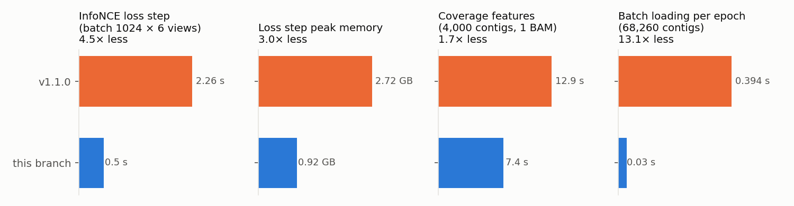

# Benchmarking the `perf-robustness` branch

## Component measurements (2026-11-03)

Laptop, 12 cores, 6 PyTorch threads, CPU only, PyTorch 2.14.0. Each value is the median of three repeats.

| Component | v1.1.0 | this branch | Change |
|---|---|---|---|
| InfoNCE loss forward + backward, batch 1024 × 6 views | 2.26 s | 0.50 s | 4.5× faster |
| Peak memory of that loss step | 2.72 GB | 0.92 GB | −1.8 GB |
| Coverage features, 4,000 contigs, 1 BAM | 12.9 s | 7.4 s | 1.7× faster; `bedtools genomecov` alone takes 7.5 s, so Python is no longer the bottleneck |
| Batch loading per epoch, 68,260 contigs | 0.394 s | 0.030 s | removes DataLoader worker processes (benchmark issue #28) |



**Is anything different?**
- **Loss:** the new loss gives the same loss, gradients and top-1/top-5 accuracy as v1.1.0 (`tests/test_info_nce.py`).
- **Batches:** seeded runs get identical batches (`tests/test_batch_loader.py`), and the first-epoch loss matches to all printed digits.
- **Coverage:** the coverage features match v1.1.0 to a relative error of 1e-15 (`tests/test_gen_cov.py`).
- **Minimal dataset:** on the 40-contig test set (the tools-iuc test data), v1.1.0 and this branch produce identical final assignments.

**Estimate for training:** an uncontended v1.1.0 batch took about 5.1 s on the 4,000-contig subset. Saving about 1.8 s per batch should make CPU training roughly 1.5× faster. A full end-to-end run has not been done yet, so treat this as an estimate.

## Full end-to-end comparison (to run on the de.NBI VM)

The laptop run was stopped for lack of free RAM at epoch 19 of the v1.1.0 run. These scripts redo it on a machine with headroom. Run the versions one after another, never at the same time:

```sh
conda activate COMEBin
export BENCH_DIR=$PWD/bench
git worktree add ../code_old origin/comebin-optimizations-v11
git worktree add ../code_new perf-robustness
benchmark/run_one.sh old ../code_old contigs.fasta bamfiles/ 6
benchmark/run_one.sh new ../code_new contigs.fasta bamfiles/ 6
benchmark/eval.sh      # CheckM Bacteria-domain quality, then figures
```

`eval.sh` calls `analyze.py`, which writes `figures/speed_stages.png` (wall time per stage), `figures/memory.png` (RSS over time), `figures/quality.png` (completeness vs contamination per bin, HQ/MQ counts, ARI between the two runs) and `figures/results.json`.

Test subset used here: 4,000 random contigs (seed 1, 6.98 Mbp) of the COMEBin demo assembly `BATS_SAMN07137077_METAG.scaffolds.min500.fasta.f1k.fasta`, with `SRR5720343.bam` reduced to those contigs (`samtools view -L`).
